# EDITHA

*Every Day I Tweak HA*

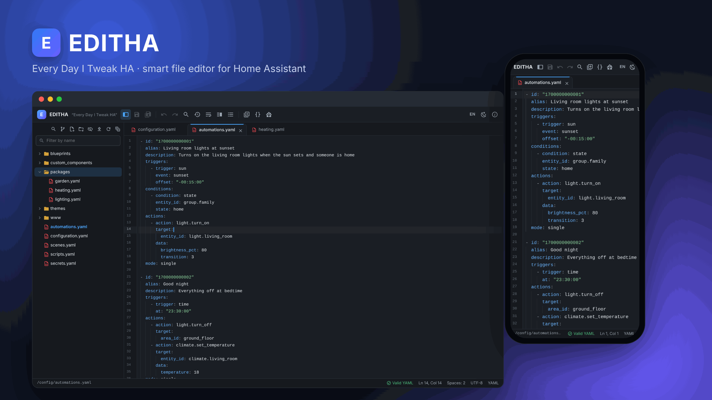

EDITHA è un editor di file per la configurazione di Home Assistant. È un add-on: si apre dalla
barra laterale e funziona su PC, tablet e telefono. Conosce Home Assistant: spiega gli errori YAML
a parole, suggerisce entità, azioni e icone, e verifica la configurazione prima di ogni riavvio.
A ogni salvataggio conserva la versione precedente, così si può sempre tornare indietro.

*English documentation: [DOCS.md](DOCS.md).* Le immagini mostrano l'interfaccia in inglese;
EDITHA è anche in italiano (pulsante della lingua in alto a destra).

## Indice

- [Installazione](#installazione)
- [La finestra in breve](#la-finestra-in-breve)
- [File e cartelle](#file-e-cartelle)
- [Modificare i file](#modificare-i-file)
- [Aiuti per Home Assistant](#aiuti-per-home-assistant)
- [Cerca e sostituisci in tutti i file](#cerca-e-sostituisci-in-tutti-i-file)
- [Cronologia e confronto](#cronologia-e-confronto)
- [Git locale](#git-locale)
- [Telefono e tablet](#telefono-e-tablet)
- [Scorciatoie da tastiera](#scorciatoie-da-tastiera)
- [Sicurezza e privacy](#sicurezza-e-privacy)
- [Problemi frequenti](#problemi-frequenti)

## Installazione

1. Aggiungi il repository a Home Assistant con questo pulsante, oppure a mano da
   **Impostazioni → Componenti aggiuntivi → Negozio → ⋮ → Repository** con l'indirizzo
   `https://github.com/Trizompa/ha-addons`.

   

2. Apri **EDITHA** nel negozio e premi **Installa**.
3. Premi **Avvia**, poi attiva **Mostra nella barra laterale**.
4. Apri EDITHA dalla barra laterale (icona a matita).

Non c'è niente da configurare. EDITHA non ha opzioni e non apre porte: si raggiunge solo
attraverso Home Assistant (Ingress), con il tuo accesso a Home Assistant.

## La finestra in breve

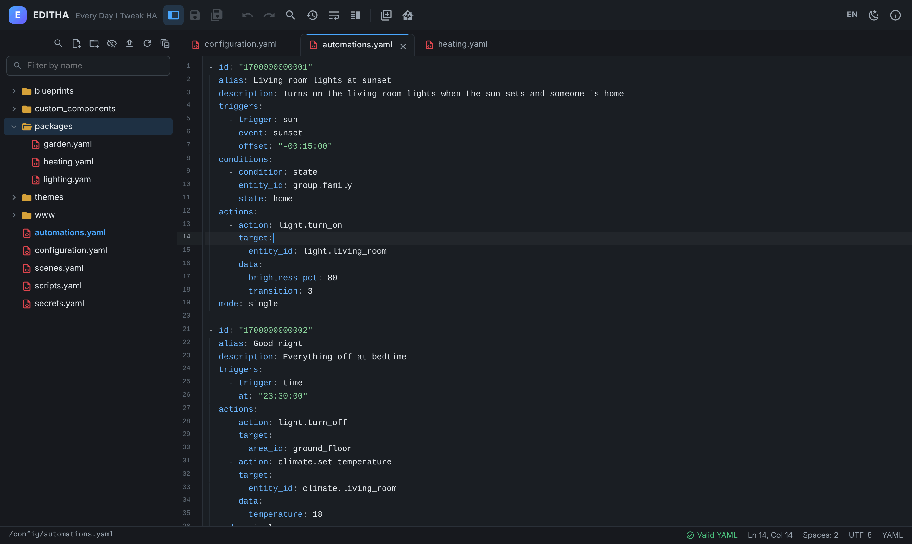

- **Barra degli strumenti** (in alto): esplora file, salva e salva tutto, annulla e ripeti, cerca
  e sostituisci, cronologia del file, a capo automatico, vista divisa, schema, pannello Inserisci e
  menu di Home Assistant. A destra: lingua (Automatica (browser), Italiano, English), tema
  (automatico, chiaro, scuro) e Informazioni.
- **Esplora file** (a sinistra): il contenuto di `/config`. Sopra: cerca in tutti i file, nuovo
  file, nuova cartella, cartelle di sistema, carica, aggiorna e comprimi tutto.
- **Tab ed editor** (al centro): una tab per ogni file aperto. Il pallino su una tab indica
  modifiche non salvate.
- **Barra di stato** (in basso): percorso del file, esito del controllo YAML, posizione del
  cursore, codifica e linguaggio.

Tab aperte, tab attiva, tema e lingua restano memorizzati quando esci da EDITHA o riavvii
l'add-on.

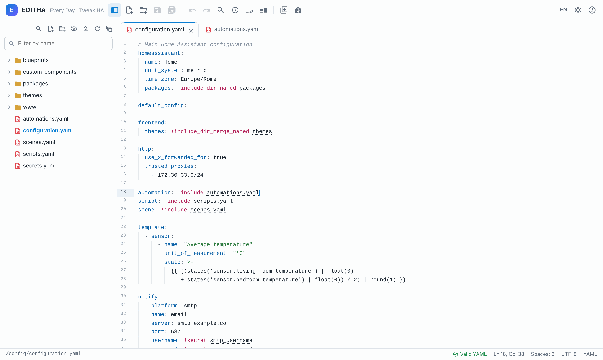

## File e cartelle

Tasto destro su un file o una cartella (pressione prolungata sul telefono) apre il menu:

| Azione | Note |
| --- | --- |
| Nuovo file / Nuova cartella | Creati dentro la cartella selezionata. |
| Apri a destra | Mostra il file nella colonna destra della vista divisa. Non per immagini e PDF (un SVG lì si apre come testo), e non sul telefono. |
| Apri come testo | Solo file SVG: si aprono in anteprima, questa voce apre il loro codice nell'editor. |
| Rinomina (F2) | Le tab aperte seguono il nuovo nome, e la cronologia del file lo segue. |
| Duplica… | Solo file. EDITHA propone `nome_copia.est`, che puoi cambiare. Una copia YAML prende anche `.bak` in fondo (`automations_copia.yaml.bak`), così Home Assistant non la carica due volte; un nome che finisce in `.yaml` chiede conferma. |
| Sposta in… | Scegli la cartella di destinazione da un elenco. Niente trascinamento, apposta: troppo facile sbagliare cartella. La cronologia segue il file. |
| Elimina (Canc) | Chiede conferma. Una copia resta nella cronologia di EDITHA (vedi [Cronologia](#cronologia-e-confronto)); per gli elementi oltre 50 MB non si può tenere una copia: EDITHA lo dice e chiede di nuovo prima di eliminarli. |
| Scarica sul PC / Scarica come zip | Un file, oppure un'intera cartella come archivio zip, fino a 50 MB. |
| Copia percorso | Il percorso completo `/config/...`. |
| Cronologia… | Le versioni salvate del file (vedi [Cronologia](#cronologia-e-confronto)). |
| Seleziona per il confronto / Confronta con *nome* | Confronta due file affiancati. |

- **Caricare file**: pulsante di caricamento, oppure trascina i file dal PC su una cartella. Fino a
  50 MB per file; sostituire un file esistente chiede conferma, e la versione precedente va nella
  cronologia (se il file esistente supera i 50 MB, EDITHA avvisa che non se ne può tenere copia).
- **Filtra per nome**: il campo sopra l'albero.
- **Immagini e PDF** si aprono in una tab di anteprima invece che nell'editor: PNG, JPEG, GIF,
  WebP, AVIF, BMP, ICO, SVG e PDF. La tab di anteprima è una sola e viene riusata dalla prossima
  immagine che apri. In alto compaiono le dimensioni in pixel e lo zoom attuale; un clic
  sull'immagine la mostra a grandezza reale (100%), un altro clic la riadatta. Le parti trasparenti
  mostrano una scacchiera. Il pulsante di download in alto salva il file sul PC. L'anteprima si
  chiude con la × della sua tab o con Esc. Per modificare un SVG usa **Apri come testo** nel suo
  menu.

  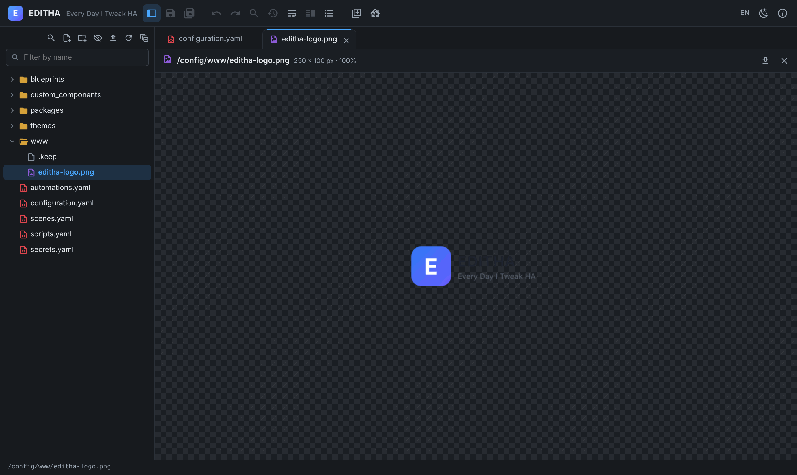
- **Cartelle di sistema** (`.storage`, `.cloud`, `deps`, `tts`, `.git`): sono nascoste. Il
  pulsante con l'occhio le mostra, **in sola lettura**: le gestisce Home Assistant e una modifica a
  mano può romperlo.

## Modificare i file

- **Salva** con Ctrl+S (Cmd+S su Mac), **salva tutto** con Ctrl+Alt+S.
- **Annulla e ripeti** annullano anche i rientri fatti con Tab.
- **Cerca e sostituisci** nel file aperto: Ctrl+F.
- **A capo automatico** e **vista divisa** sono nella barra. La vista divisa mostra due file
  affiancati, oppure due punti dello stesso file: le modifiche fatte in una colonna compaiono
  nell'altra. **Apri a destra** nel menu di un file lo mette subito nella colonna destra.

  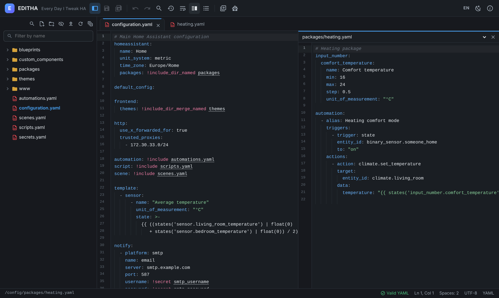

- **Schema del file**: il pulsante con l'elenco puntato apre, a fianco dell'editor, lo schema del
  file YAML: in `automations.yaml` una voce per automazione, con il suo alias; in `scripts.yaml`
  una per script; in `configuration.yaml` e nei package le sezioni, con dentro automazioni, script
  e helper. Un clic porta alla voce; la voce in cui si trova il cursore resta evidenziata, e lo
  schema segue le modifiche mentre scrivi. Con molte voci compare in alto un filtro. Il pulsante
  accende e spegne lo schema, e EDITHA ricorda la scelta. Sul telefono non è disponibile.

  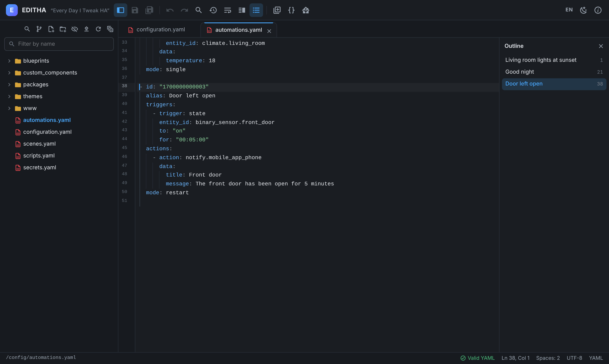

- **Linguaggi**: YAML, JSON, Python, JavaScript, TypeScript, CSS, Markdown e template Jinja
  (`.jinja`, `.jinja2`, `.j2`) sono colorati; gli altri file si aprono come testo semplice.
  Immagini e PDF si aprono in anteprima; gli altri file binari e quelli oltre 5 MB non si aprono
  nell'editor, ma si possono scaricare.

### Il lavoro non si perde

- Chiudere una tab o la pagina con modifiche non salvate chiede conferma.
- Se la pagina si chiude comunque (telefono bloccato, browser chiuso), EDITHA conserva le modifiche
  non salvate come **bozza** e la volta dopo propone di recuperarle (Esc rimanda la scelta: le
  bozze restano, e alla prima modifica di uno di quei file EDITHA lo chiede di nuovo). Se il file non esiste più
  (rinominato o eliminato da un'altra parte), EDITHA propone di ricrearlo con quelle modifiche; la
  bozza di un file che non si può più salvare (per esempio è diventato di sola lettura) viene
  scartata con un avviso. La stessa scelta di ricreare il file compare se salvi un file che nel
  frattempo è stato rinominato o eliminato da un'altra parte.
- Con EDITHA aperta in più finestre o dispositivi, ognuno tiene le sue bozze: una finestra non
  propone, scarta o sovrascrive mai le bozze di un'altra ancora aperta. Se una finestra si chiude
  senza salvare (o il telefono chiude l'app), un'altra finestra aperta propone le sue modifiche
  dopo circa un minuto e mezzo.
- Se EDITHA smette di rispondere per un momento (aggiornamento o riavvio dell'add-on), lascia la
  pagina aperta: le modifiche restano nelle tab e le bozze si scrivono appena torna. **Ricarica la
  pagina** nel banner scrive prima le bozze, e avvisa se EDITHA non risponde ancora.
- Se un file aperto cambia su disco (per esempio lo ha riscritto Home Assistant), EDITHA avvisa
  prima di salvare: scegli tu se ricaricarlo o sovrascriverlo.

## Aiuti per Home Assistant

### Controllo YAML spiegato

EDITHA controlla lo YAML mentre scrivi. Conosce i tag di Home Assistant (`!include`,
`!include_dir_*`, `!secret`, `!input`, `!env_var`) e, al posto del messaggio criptico della
libreria, dice cosa non va e in quale riga: due punti mancanti, una riga al livello di rientro
sbagliato, una tabulazione al posto degli spazi, uno spazio speciale invisibile incollato da una
pagina web, una chiave ripetuta, un template `{{ … }}` senza virgolette, un apostrofo dentro `'…'`,
un `: ` dentro un testo senza virgolette, un elenco o un blocco `{ }` usato come chiave, un alias
`*nome` senza un'ancora `&nome` prima, un tag sconosciuto (`!secrets` invece di `!secret`). Nella
cartella `esphome` sono accettati anche i tag di ESPHome (`!lambda`, `!extend`, `!remove`, …).

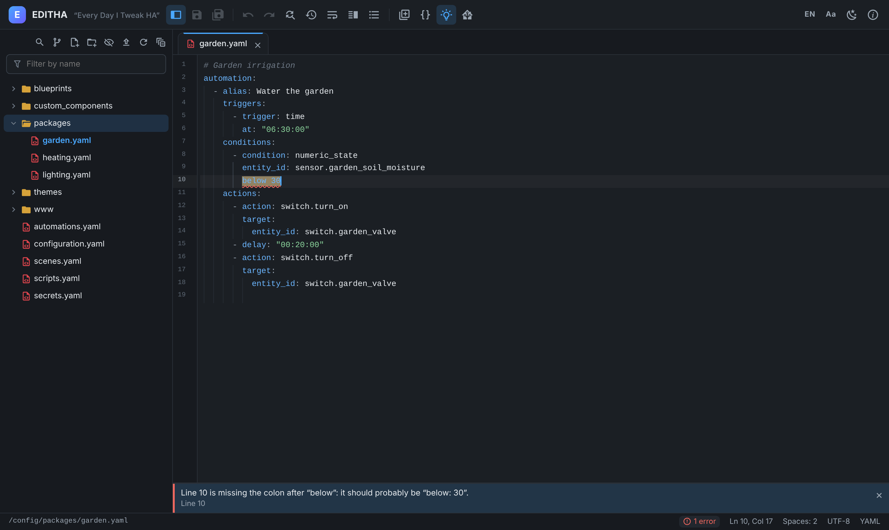

Avvisa anche di errori tipici di Home Assistant che sono YAML valido, come `on`/`off`/`yes`/`no`
senza virgolette (lo YAML li trasforma in vero/falso) o `name:Casa` senza lo spazio dopo i due punti.

I file molto grandi (oltre 1 MB) non vengono controllati e non hanno lo schema, così l'editor resta
reattivo.

Clic sul numero di errori nella barra di stato (oppure Ctrl+Maiusc+M) apre l'elenco dei problemi;
F8 passa al successivo.

### Suggerimenti mentre scrivi

Premi Ctrl+Spazio, oppure scrivi e basta:

- **entità** con nome e stato attuale, dopo `entity_id:` o appena scrivi un dominio come `light.`;
- **azioni** (`light.turn_on`, …) dopo `action:` o `perform_action:` (i nomi delle azioni, non i
  loro campi);
- **chiavi `!secret`** da `secrets.yaml` (solo i nomi: i valori non vengono mai inviati per i
  suggerimenti);
- **icone Material Design** dopo `mdi:`, con l'anteprima.

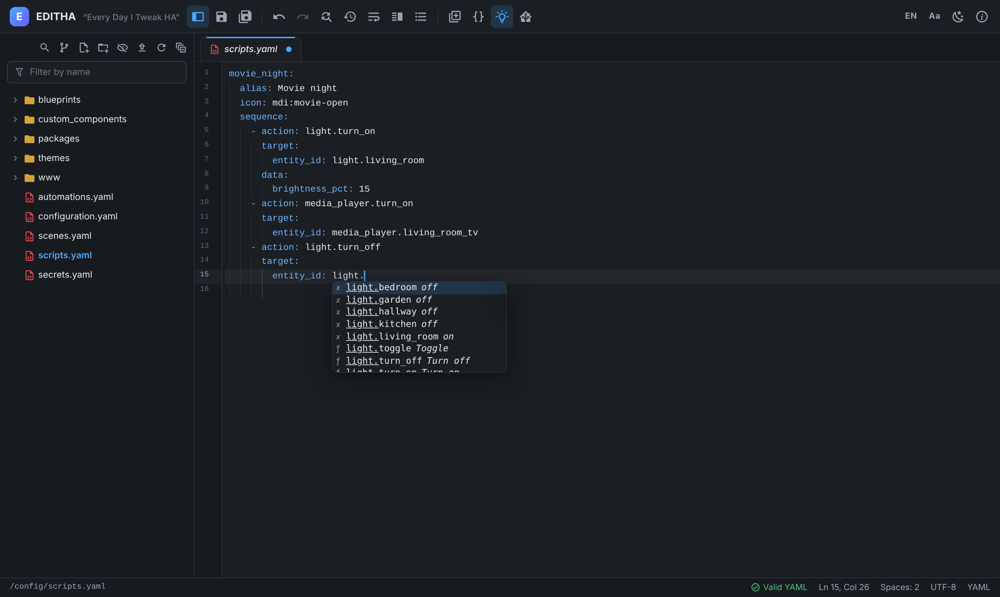

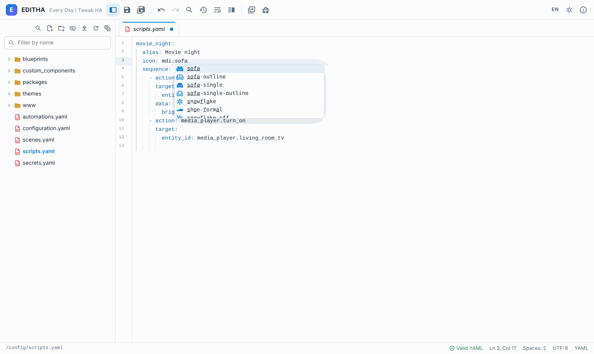

### Seguire include e secret

Ctrl+clic (Cmd+clic su Mac) su `!include file.yaml` apre il file, su `!include_dir_* cartella`
mostra la cartella nell'albero, su un nome `!secret` apre `secrets.yaml` a quella chiave.

### Pannello Inserisci

Il pulsante Inserisci apre un pannello laterale con due schede:

- **Entità**: cerca per nome o `entity_id` e inserisci nel punto del cursore. La lente accanto a
  un'entità mostra dove è usata nella configurazione.
- **Snippet**: blocchi pronti (automazione, script, sensore template, trigger, condizioni, azioni,
  helper). Tab passa da un campo da compilare al successivo. Seleziona del testo e salvalo come
  **snippet personale**; la matita lo modifica.

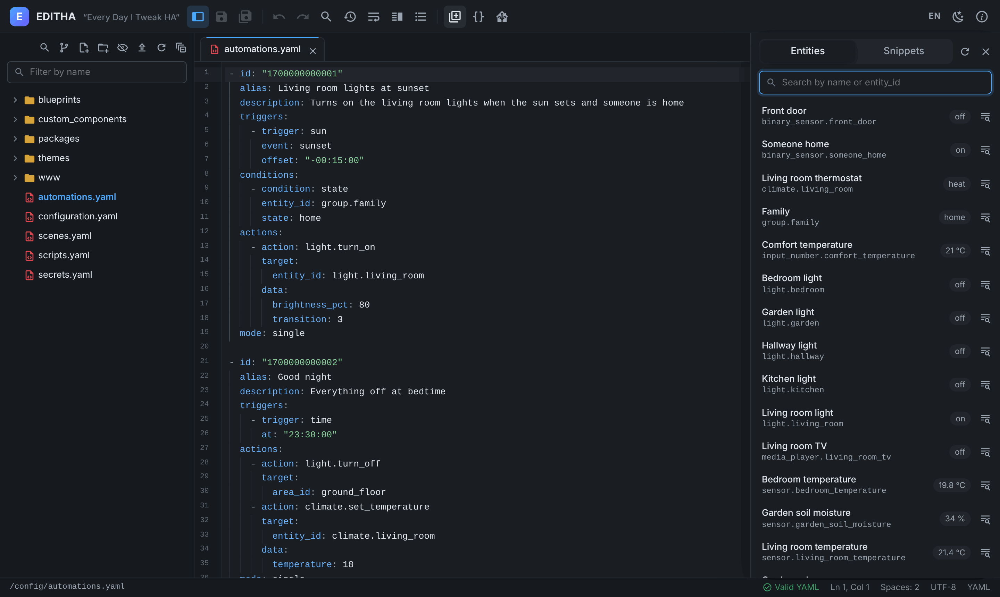

### Verifica, ricarica, riavvia

Il pulsante di Home Assistant nella barra:

- **Verifica configurazione**: chiede a Home Assistant di controllare tutta la configurazione e
  mostra l'esito.
- **Ricarica configurazione YAML**: prima verifica, poi ricarica automazioni, script, scene e tutto
  lo YAML che si può ricaricare senza riavviare.
- **Riavvia Home Assistant**: chiede conferma e **verifica sempre prima**: se la configurazione ha
  errori il riavvio viene annullato, così un errore di battitura non ti lascia senza Home
  Assistant.

Home Assistant legge i file su disco: se alcune tab hanno modifiche non salvate, EDITHA chiede prima
se **Salva tutto e continua** o **Continua senza salvare**.

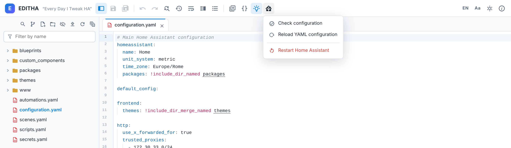

### Anteprima dei template

Metti il cursore su un template (o selezionalo) e premi **Alt+T**, oppure usa il pulsante
**Anteprima template** nella barra (le parentesi graffe) o la voce nel menu di Home Assistant. Senza selezione EDITHA prende il valore sotto il cursore,
letto come lo legge Home Assistant: anche su più righe (`value_template: >`, `|`, virgolette che
vanno a capo). Nei file `.jinja` prende il file intero.

Il risultato lo calcola Home Assistant con lo stato attuale delle entità, come in Strumenti per
sviluppatori, e compare in un pannello sotto l'editor: in verde il risultato, in rosso un errore di
sintassi, in arancione un errore di valutazione (per esempio una divisione per zero).

- Con il pannello aperto l'anteprima si aggiorna da sola: mentre modifichi il template, poco dopo
  che smetti di scrivere, e quando sposti il cursore (o fai clic) su un altro template, anche in
  un altro file. Su una riga senza template resta il risultato di prima. Un testo selezionato si
  manda solo con Alt+T o il pulsante (così selezionare per copiare non fa partire niente), e nei
  file YAML molto grandi l'aggiornamento automatico è spento. Il pulsante di aggiornamento
  ricalcola dal punto in cui si trova il cursore.
- **Copia** copia il risultato.
- Se il template cita entità che non esistono (per esempio `states('sensor.sbagliato')`), sotto il
  risultato compare un avviso: Home Assistant in quel caso non dà errore, risponde `unknown`.
- Home Assistant non dice in che riga sta un errore di sintassi: quando può, la trova EDITHA (un
  `` senza ``, un `{{` non chiuso…) e offre **Vai alla riga N**.
- Esc chiude il pannello. Variabili
come `trigger`, `this` o quelle di un'automazione esistono solo mentre l'automazione gira: qui
risultano vuote. Da `secrets.yaml` e dalle sue copie l'anteprima non parte mai.

## Cerca e sostituisci in tutti i file

La lente sopra l'esplora file (Ctrl+Maiusc+F) apre **Cerca nei file**: cerca in tutti i file di
`/config`, con maiuscole/minuscole, parola intera ed espressioni regolari. Clic su un risultato apre
il file a quella riga. Cerca un `entity_id` con *parola intera* per trovare tutti i punti in cui è
usato.

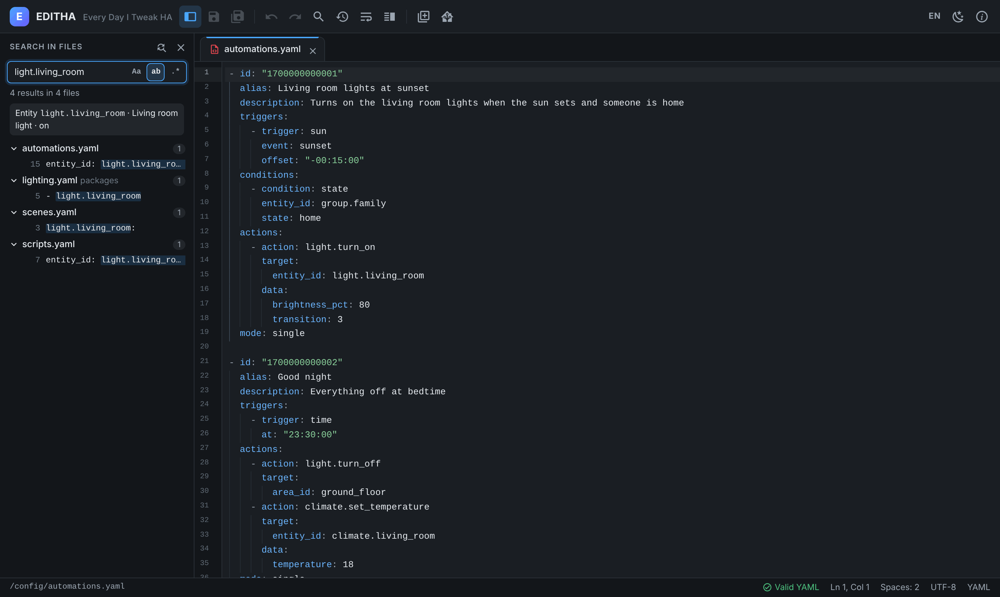

La ricerca salta le cartelle di sistema, i collegamenti, i file oltre 5 MB e i file binari
(database, archivi, immagini e simili). Con troppi risultati (2000) o una ricerca troppo lunga
mostra i primi trovati.

Il pulsante con le frecce apre **Sostituisci nei file**. **Sostituisci tutto** cambia tutte le
occorrenze dopo una conferma; se la ricerca si è fermata prima (troppi risultati), cambia solo i
file elencati; **Sostituisci in *nome*** accanto a un file sostituisce solo lì. Ogni
file modificato conserva la versione precedente nella cronologia. I file con modifiche non salvate,
`secrets.yaml` con le sue copie e le cartelle di sistema non vengono mai toccati.

`secrets.yaml` e le sue copie (come `secrets.yaml.bak` o `secrets_old.yaml`) sono esclusi dalla
ricerca: password e chiavi non compaiono mai nei risultati.

## Cronologia e confronto

Prima di ogni salvataggio, sostituzione, ripristino o eliminazione, e prima che un file caricato ne
sostituisca uno esistente, EDITHA conserva la versione precedente del file (le ultime **10
versioni** di ogni file). Rinominando o spostando un file la cronologia lo segue, senza aggiungere
versioni. Il pulsante cronologia nella barra (oppure **Cronologia…** nel menu del file) mostra le
versioni accanto al contenuto attuale, con le differenze evidenziate; **Ripristina questa
versione** la riporta indietro (e si può annullare a sua volta, perché anche il contenuto attuale
viene conservato). La cronologia funziona sui file di testo fino a 5 MB.

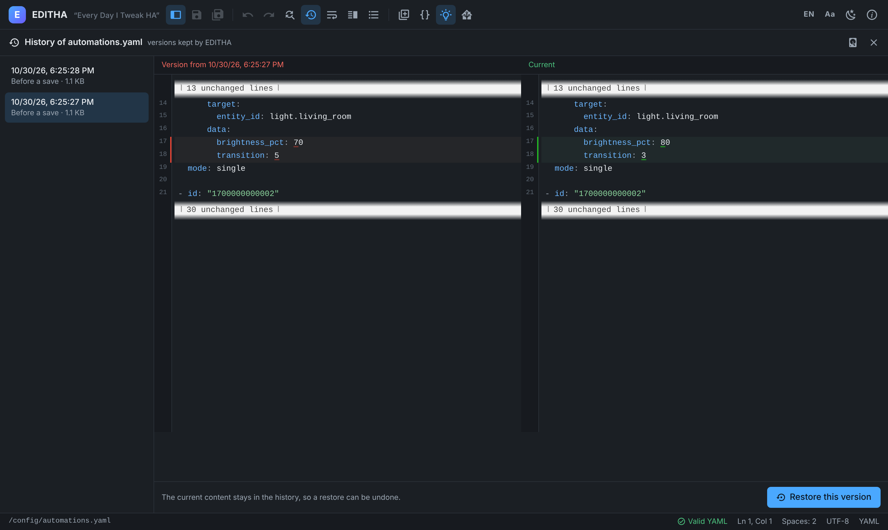

**Recuperare un file eliminato**: crea un nuovo file con lo stesso nome nella stessa cartella, poi
apri **Cronologia…** su di lui: le sue versioni sono ancora lì, compresa quella conservata
all'eliminazione. Le cartelle non si possono ripristinare così, e degli elementi oltre 50 MB non
resta copia (EDITHA avvisa prima di eliminarli).

**Spazio occupato dalla cronologia**: in **Informazioni** (riga *Cronologia*, **Spazio e
pulizia…**) o con il pulsante a forma di disco nell'intestazione della cronologia, EDITHA mostra
quanto spazio occupa la cronologia sul disco, in tutto e file per file, dai più pesanti, segnalando
i file che non esistono più. Sotto puoi eliminare le versioni più vecchie di 7, 30, 90 giorni, un
anno o una data a scelta: prima **Anteprima** dice quante versioni di quanti file se ne andrebbero
e quanto spazio liberano, poi **Elimina N versioni…** chiede conferma. L'ultima voce, **tutte**,
cancella l'intera cronologia (compresi gli avanzi di salvataggi interrotti): per confermare bisogna
scrivere **CANCELLA**. Le versioni eliminate non si possono più ripristinare; i tuoi file in
`/config` e le modifiche non salvate non vengono mai toccati. Il registro dell'add-on elenca cosa
è stato eliminato.

Per confrontare due file qualsiasi: tasto destro sul primo → **Seleziona per il confronto**, poi
tasto destro sul secondo → **Confronta con *nome*** (il nome del primo file). Esc chiude il
confronto.

La cronologia sta nello spazio dell'add-on, che viene incluso quando fai il backup dell'add-on.

## Git locale

Il pulsante **Git** (il ramo, in alto nell'esplora file) apre il pannello Git al posto dell'albero.
Tutto resta sul tuo Home Assistant: EDITHA usa solo il repository in `/config` e non invia niente
fuori (niente GitHub né altri server).

- Se in `/config` non c'è ancora un repository, **Inizializza repository Git** lo crea (ramo
  `main`) insieme a un file `.gitignore` di base, che tiene fuori password e chiavi
  (`secrets.yaml` e copie), i dati interni di Home Assistant (`.storage`, `.cloud`, `deps`,
  `tts`…), database, registri e file temporanei. Puoi modificarlo come ogni altro file.
- Un repository o un `.gitignore` che esistono già si usano così come sono.
- Il pannello mostra il ramo, l'ultimo commit e le **modifiche** dall'ultimo commit: ogni file con
  una lettera (**M** modificato, **N** nuovo, **E** eliminato, **C** in conflitto) e una casella. Un clic sul nome apre
  il file. L'elenco si aggiorna quando salvi un file con il pannello aperto, o con il pulsante di
  aggiornamento.
- Una cartella che git non ha mai visto è **una riga sola**, con il numero di file che contiene
  (per esempio `custom_components/ · 1450 file`). L'**occhio barrato** accanto a un file o a
  una cartella nuovi li **esclude** dal repository: aggiunge una riga al `.gitignore`, così non
  compaiono più. Al primo commit, che di solito contiene tutta la configurazione, conviene
  escludere prima le cartelle che non servono (scaricate da HACS, copie di altri add-on…).
- Per fare un **commit** (una «fotografia» dei file, con un messaggio): lascia spuntati i file da
  includere (all'inizio ci sono tutti), scrivi cosa hai cambiato e premi **Commit** (o
  Ctrl+Invio nel messaggio).
- Alcuni file non entrano mai in un commit da EDITHA, anche se il `.gitignore` è stato cambiato o
  manca: compaiono con un lucchetto e non si possono spuntare. Sono `secrets.yaml` e le sue copie, i
  dati interni e le credenziali di Home Assistant (`.storage`, `.cloud`, token, database), i file
  che passano da un filtro di git (`.gitattributes`, per esempio Git LFS o git-crypt: EDITHA non
  esegue programmi esterni, quindi li salverebbe senza filtro; vanno committati da un terminale) e gli altri repository dentro `/config`.
- Il pulsante del confronto (le due colonne) accanto a un file mostra le differenze rispetto all'ultimo commit,
  nella stessa vista del confronto tra file (anche con le modifiche non ancora salvate).
- **Storia dei commit** elenca i commit, dal più recente. Un clic su un commit mostra i file che ha
  toccato; per ciascuno puoi **confrontare** quella versione con il file attuale o
  **ripristinarlo** com'era in quel commit (con conferma). Il ripristino passa dal normale
  salvataggio di EDITHA: il contenuto attuale resta nella cronologia di EDITHA, e un file che ora
  non c'è viene ricreato. Segreti e dati interni non si mostrano né si ripristinano.
- I file nuovi che compaiono da soli mentre il pannello è aperto (dopo un salvataggio o
  un'operazione sui file) arrivano senza spunta: decidi tu se
  includerli.
- Durante un'unione (merge), un rebase o un cherry-pick avviati da un terminale i commit da EDITHA sono sospesi: completala o
  annullala dal terminale.

La cronologia di EDITHA (le copie automatiche a ogni salvataggio) resta separata e continua a
funzionare come prima.

## Telefono e tablet

EDITHA funziona nell'app di Home Assistant. Su uno schermo stretto l'esplora file diventa un
pannello che si apre dal pulsante nella barra, e la barra mostra solo i pulsanti principali:
**Cronologia…** sta nel menu del file (pressione prolungata sul file) e **Informazioni** nel menu
del pulsante della lingua. Vista divisa, **Apri a destra** e schema del file non sono disponibili
sul telefono. Su telefono e tablet un piccolo pulsante accanto al cursore chiude la tastiera.

| Editor | Esplora file |
| --- | --- |
| 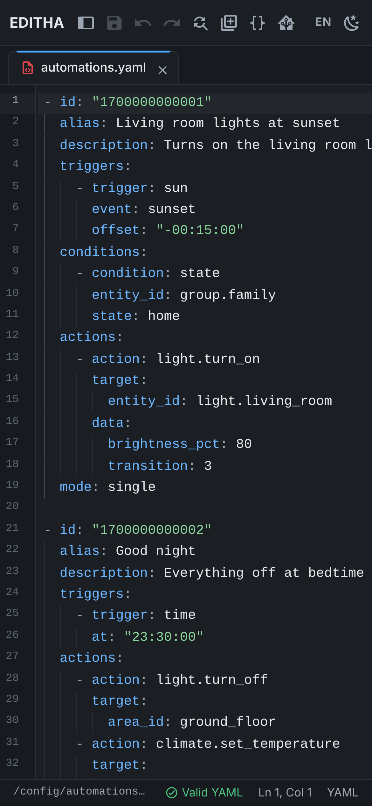 | 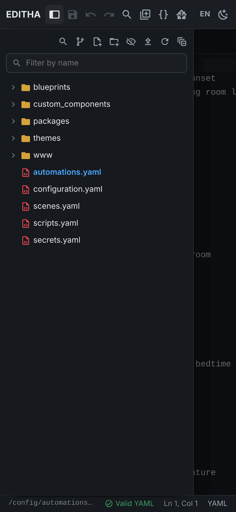 |

## Scorciatoie da tastiera

Su Mac usa Cmd al posto di Ctrl e Opzione al posto di Alt; due eccezioni: ripeti è
Cmd+Maiusc+Z e i suggerimenti restano Ctrl+Spazio.

| Tasti | Azione |
| --- | --- |
| Ctrl+S | Salva |
| Ctrl+Alt+S | Salva tutto |
| Alt+W | Chiudi la tab (Opzione+W su Mac) |
| Ctrl+Z / Ctrl+Y | Annulla / ripeti (Cmd+Z / Cmd+Maiusc+Z su Mac) |
| Ctrl+F | Cerca e sostituisci nel file |
| Ctrl+Maiusc+F | Cerca in tutti i file |
| Ctrl+Spazio | Suggerimenti (Ctrl anche su Mac) |
| Tab / Maiusc+Tab | Aumenta / riduci il rientro |
| Ctrl+clic | Apri un `!include` o un `!secret` |
| Ctrl+Maiusc+M | Elenco dei problemi |
| F8 | Problema successivo |
| F2 | Rinomina (nell'esplora file) |
| Canc | Elimina (nell'esplora file) |
| Alt+T | Anteprima del template sotto il cursore (Opzione+T su Mac) |
| Esc | Chiudi la cronologia, il confronto o l'anteprima |

## Sicurezza e privacy

- **Nessuna porta esposta**: EDITHA risponde solo al proxy Ingress di Home Assistant.
- **Solo `/config`**: nessun file fuori dalla cartella della configurazione può essere letto o
  scritto.
- **Salvataggi sicuri**: il file viene scritto in una copia temporanea e poi sostituito, così un
  disco pieno o un crash non lo lasciano mai scritto a metà.
- **Secret**: i valori di `secrets.yaml` si vedono solo aprendo quel file. Non arrivano mai al
  browser per i suggerimenti e non finiscono nei log; `secrets.yaml` e le sue copie non vengono
  mai cercati né modificati da una sostituzione.
- **Cartelle di sistema** in sola lettura.
- **Nessun bisogno di internet**: tutto quello che serve a EDITHA è dentro l'add-on.

## Problemi frequenti

**Dopo un aggiornamento l'icona o il titolo nella barra laterale non cambiano.** Home Assistant li
tiene in memoria: spegni e riaccendi *Mostra nella barra laterale* nella pagina dell'add-on,
oppure riavvia Home Assistant.

**Nessuna entità nei suggerimenti o nel pannello Inserisci.** EDITHA le legge da Home Assistant:
controlla che Home Assistant sia in funzione e premi il pulsante di aggiornamento nel pannello
Inserisci.

**Un file non si apre.** I file oltre 5 MB e i file binari (tranne immagini e PDF) non si possono
aprire: scaricali (fino a 50 MB).

**Altro?** Apri una segnalazione su [GitHub](https://github.com/Trizompa/ha-addons/issues) con
cosa hai fatto, cosa ti aspettavi e, se puoi, il log dell'add-on (pagina dell'add-on → *Registro*).
